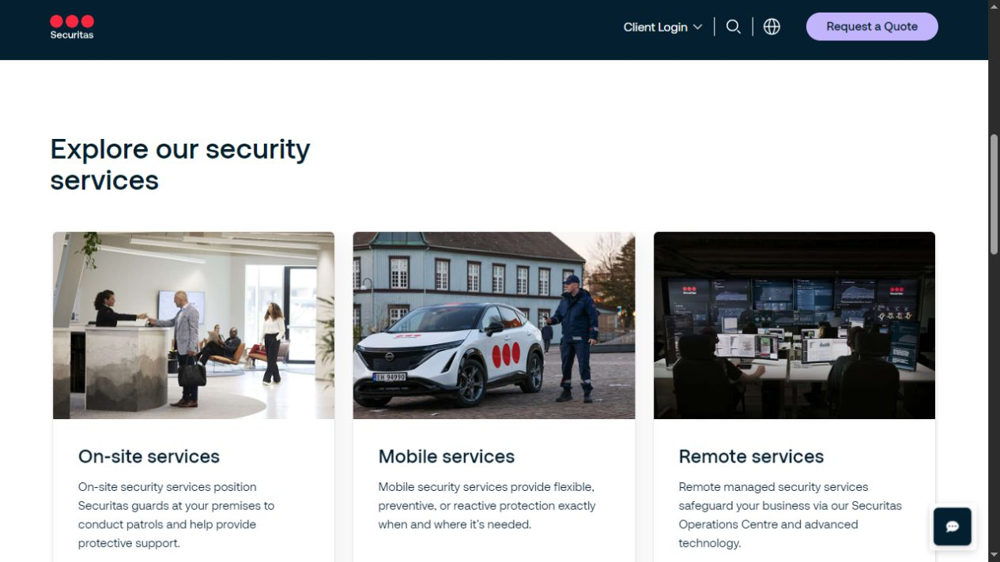
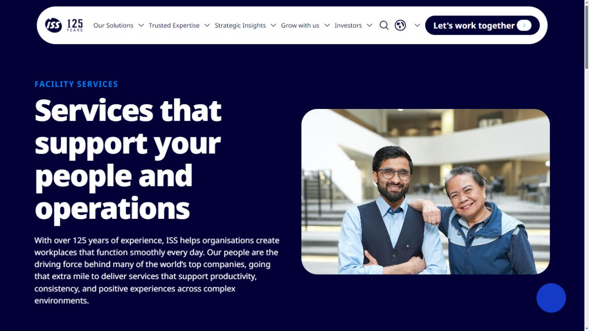
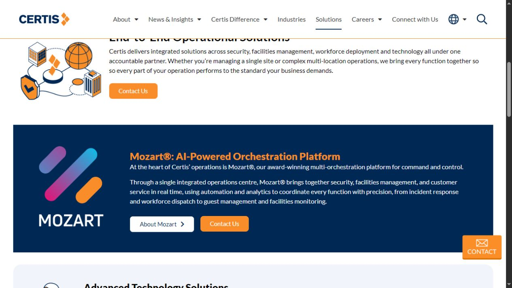

# International website research and Winstar design philosophy

Research date: 16 October 2026. Status: recommended working direction for discussion; does not overwrite accepted design decisions. No website design changed in this research pass.

## Scope and evidence

Reviewed official content from Securitas Group and USA, GardaWorld, Allied Universal, Wilson Security (Australia), Certis (Singapore), Mitie (UK), ISS and Axis. Visually inspected desktop pages from Securitas USA, Mitie, Certis and ISS. Local Securex content was consulted for market context. BM Security could not be retrieved and G4S Kenya returned no readable content in the research tool; neither is visually assessed here.

This is comparative content and design research, not a complete UX, accessibility, performance or mobile audit. Screenshots show selected desktop states. Forms were not submitted. Company claims belong to those companies and are not evidence of Winstar capabilities. Recommendations below are our design judgement, not proven conversion results.

## Most useful references

| Reference | Observed pattern | Application to Winstar | Boundary |
|---|---|---|---|
| [Securitas USA services](https://www.securitasinc.com/products-and-services/) | A clear introduction, photo-led service categories and general selection FAQs. Images depict different work contexts. | Retain our three groups and make each photograph explain its category. Keep practical buying questions on this page. | Do not import free assessments, support hours or other commercial promises. |
| [Mitie guarding](https://www.mitie.com/all-services/security/security-guarding/) | Plain service name, light large heading, section navigation, image/text overview, capability evidence, FAQs and case studies. | Best reference for the information architecture of detailed service pages. Explain delivery and support as well as duties. | Its long editorial feed and many sections would overwhelm shorter Winstar pages. |
| [ISS services](https://www.issworld.com/services) | People occupy prominent photography; service descriptions connect work to business outcomes. Desktop introduction pairs copy with a substantial photograph. | Show approachable, competent staff at work. Connect security to everyday operations and customer experience. | Retain Winstar’s sharper geometry rather than copying ISS’s rounded navigation and imagery. |
| [Certis solutions](https://www.certisgroup.com/solutions/) | Connects frontline services with the systems that coordinate operations. Gives its operations platform a distinct panel. | Explain the management, coordination and support behind Winstar’s guards and equipment. | Content reference stronger than visual reference for this project. Do not adopt its AI or platform claims. |
| [Wilson Security personnel](https://www.wilsonsecurity.com.au/services/security-personnel/) | Service explanation, applications, client evidence, quote route and focused FAQs. | Place relevant evidence alongside a service and answer real deployment questions. | Do not borrow Australian regulatory language or duplicate separate Services and Solutions navigation. |
| [Allied Universal security professionals](https://www.aus.com/security-services/security-professionals) | Connects frontline personnel to organisational support and related specialisms. | Support capacity positioning with specific operational details. | Avoid generic superlatives and a scale-based contest with multinational firms. |
| [Axis solutions](https://www.axis.com/en-us/solutions) | Distinguishes industries from application areas, with customer stories alongside the offer. | Service pages explain what a solution does; sector pages explain where and why it matters. | Manufacturer catalogues are deeper than a security buyer needs here. |
| [GardaWorld](https://www.garda.com/) | Emphasises recruitment, training and support alongside customer stories. | Staff quality and support can be concrete evidence of delivery capability. | Recruitment is not a primary Winstar website journey; Careers remains out of scope. |

[Securitas Group](https://www.securitas.com/) and [ISS corporate](https://www.issworld.com/) also illustrate why global homepages are not automatically good customer-facing models: investor, editorial and recruitment needs share their attention. [Securex](https://securexafrica.com/) remains a local market reference, not the chosen styling benchmark.

## Visual evidence

### 1. Securitas service selection

Clear image/title/description relationships make categories easy to scan. The useful detail is photography of people, vehicles and control-room work. For Winstar, generic office buildings cannot carry the same explanatory weight. The captured card row is a useful hierarchy reference; no mobile or full interaction assessment was performed.

### 2. Mitie service-page opening

A light heading, short introduction and section links provide a clear hierarchy. Winstar can use a smaller version of this heading treatment. Section navigation is useful only when page length justifies it. The captured page also contains a third-party cookie-related overlay; we should not reproduce that obstruction.

### 3. ISS service introduction

A solid background separates text from a large people-focused photograph. This is a useful alternative to placing all headings over images. Its heavy typography and pill shapes are not Winstar’s recommended direction.

### 4. Certis operational-capacity panel

A contrasting panel singles out the operating system behind the service. For Winstar, use an equivalent content role for verified supervision and coordination practices. The pictured proprietary technology and its claims belong to Certis. The scrolled capture is evidence of the panel treatment, not a complete page composition.

## Recommended philosophy: visible competence, clearly explained

The site should help a visitor understand the service, recognise its relevance and see the organisation capable of delivering it. Build confidence through specific explanations and appropriate photography. Let the quiet precision of spacing, alignment and typography reinforce that message.

### Content rules

1. Each page has a primary job. Home establishes confidence; Our Solutions helps selection; service pages explain delivery; sector pages demonstrate understanding of the operating environment; Company substantiates capacity; Contact enables an enquiry.
2. Use a clear service name in the H1. An expressive supporting phrase can follow, but should not replace the visitor’s search term.
3. Explain benefits through concrete activities. For example, describe entry management, patrol duties and reporting once confirmed, instead of repeating that security is reliable or world-class.
4. Distinguish service scope from optional arrangements. Staffing hours, coverage, equipment integration, maintenance and response terms require confirmation before becoming promises.
5. Keep introductory paragraphs around 40–70 words, supporting paragraphs around 40–90, and a module focused on one idea. These are editing guides, not quotas.
6. Prefer a relevant photograph and a specific caption to decorative icon grids. Reserve icons for controls or concise functional cues.
7. Use evidence where it strengthens the claim: approved site photography, documented processes, named credentials, approved client examples or genuine attributed quotes. An unsupported badge or statistic adds no credibility.
8. Link service and sector pages selectively. Avoid repeating the entire service catalogue at the bottom of every page.

### Proposed page families

**Our Solutions overview:** concise introduction → three photo-led groups with all ten service links → optional short explanation of how services work together → general FAQs → enquiry. Our current rough-out already fits this. Add an integration panel only if it adds substance rather than repeating the introduction.

**Individual service:** breadcrumb → service title, benefit statement, photograph and CTA → what the service covers → how Winstar delivers it → relevant applications or sectors → one supported proof point where available → 3–5 focused FAQs → enquiry. Include 2–3 related services only where genuinely helpful. Essential scope remains visible, not hidden in an accordion.

**Sector:** sector name and contextual photograph → practical operating priorities → appropriate combination of services → how delivery adapts to that environment → approved relevant evidence → enquiry. These pages should not be service pages with the industry name substituted.

**Company:** introduction and operations since 2001 → management and operational support → personnel/training → equipment, fleet and facilities → credentials and commitments → enquiry. Build this around available evidence, with missing items recorded internally.

**Policies:** restrained text layout, narrow reading column, clear section headings and review dates when confirmed. No decorative hero, document downloads or forced sales sections.

### A reusable visual vocabulary

| Element | Proposed rule |
|---|---|
| Typography | Lab Grotesque throughout; 300 for large display headings, 400 for body, 500 for small headings, 700 for labels. Keep Integral CF as the existing homepage accent rather than spreading it through every page. |
| Heading sizes | Desktop page titles 44–56px; section headings 32–40px; tile headings 22–26px. Mobile titles 32–38px; section headings 26–32px. Final values checked in the actual layout. |
| Body copy | 16–17px, line-height 1.55–1.7, approximately 55–70 characters per line. Compact navigation can retain its existing 13px scale. |
| Colour | White and almost-white for reading; slate #39375b for emphasis and menus; deeper footer colour retained; red #ec1e24 for actions and sparse accents; pale blue #95d6e2 for supporting CTA surfaces. Check contrast for each pairing. |
| Layout | Shared content width around 1280–1296px, 5% outer gutters, 64–80px desktop section spacing and 40–48px on mobile. Use one consistent spacing scale. |
| Composition | Alternate open text, photo/text split, photo-led cards, and one contrasting evidence panel when useful. Avoid turning every section into equal cards. |
| Imagery | Consistent crops within each module, usually 3:2 or 16:10. Protect faces, uniforms and equipment in mobile crops. Images should explain the adjacent content. |
| Geometry | Predominantly square edges; small radii only where already established. Use the red rule and occasional clipped corner sparingly as Winstar accents. No additional ornamental motif needed. |
| Actions | Reuse the existing rectangular CTA with red chevron and wipe interaction. Clear destination labels; one main action per section. |
| Motion | Short, restrained transitions for controls; reduced-motion alternatives. Essential information should remain immediately readable. Retain the accepted homepage slider treatment as a special case, not a template for internal pages. |

### Small component set to build once

1. Internal-page introduction with breadcrumb, H1, short copy and optional image.
2. Photo-led linked card with predictable image ratio and text spacing.
3. Image/text split for scope or delivery details.
4. Compact evidence panel, optionally using a red rule or the established corner cut.
5. FAQ disclosure row with visible focus and keyboard support.
6. Related-service links and closing enquiry panel.

Reuse the existing header, footer and CTA. Implement shared internal-page styles once the first detailed page is reviewed. Consolidate repeated rules instead of accumulating overrides for every page.

### Photography brief

Prioritise Winstar guards at a reception or gate; a supervisor briefing staff; a guard using a radio; a handler with a dog; technicians installing or checking CCTV/access equipment; a permitted control-room view; turnstiles or barriers in their setting; and suitable perimeter installations. Include management/support staff and facilities where they substantiate organisational capacity. Aviation photos must accurately represent authorised Winstar work.

Seek horizontal compositions with room for crops, consistent natural colour and tidy professional presentation. Capture both staff and their operating environment. Do not use competitors’ branded staff or equipment as Winstar imagery. Stock photography may illustrate a setting, but must not be presented as proof of Winstar’s installations or workforce.

### FAQ policy and draft topics

The overview answers how to choose and combine services, what the categories mean and what to prepare for an enquiry. Keep 4–5 useful questions there.

Service-page topics to develop after confirming scope:
- Guarding: duties, site instructions, supervision, handovers and coverage arrangements.
- Canine: suitable settings, handler arrangements and managing interaction with visitors.
- CCTV: coverage planning, low-light needs, access to footage, storage and maintenance.
- Biometric/card access: permissions, visitors, lost cards and power interruption arrangements.
- Alarms: installation versus monitoring/response, escalation and maintenance.
- Barriers/fencing: site suitability, pedestrian/vehicle movement, power and servicing.
- Events/escorts/aviation: advance information needed, coordination and the boundaries of the commissioned service.

These are content questions, not confirmed capabilities. Answer only what Winstar can support. Do not copy a competitor’s legal requirements, guarantees or technical specifications. Avoid artificial questions that merely repeat the page introduction.

## Next implementation sequence

1. Review this philosophy and use it as the working brief.
2. Refine the overview’s imagery and tighten descriptions without redesigning its accepted structure.
3. Build Manned Guarding as the first detailed service page, including the delivery/evidence section and focused FAQs.
4. Review its desktop and mobile layout, then extract shared styles/components.
5. Adapt the pattern to Canine Security and one electronic service to test its flexibility before rolling it across all services.
6. Develop the sector template separately; it answers a different buyer question.

## Priority evidence to obtain

Actual training and supervision arrangements; reporting/escalation practices; service coverage and hours; installation/support scope; approved operational photographs; and genuine customer statements. User-confirmed professional operations since 2001 and valid Data Processor Certificate can inform copy, without publishing the certificate number. Client names alone do not establish the services supplied at each site.
